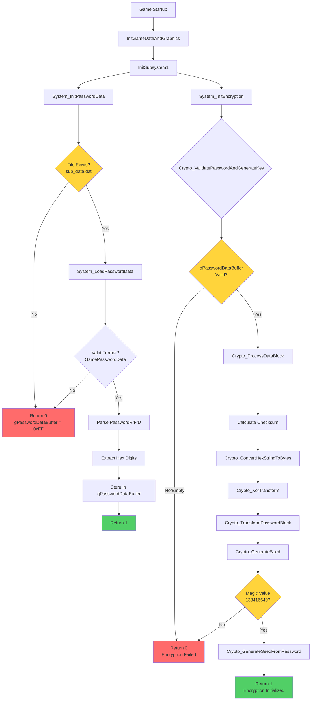
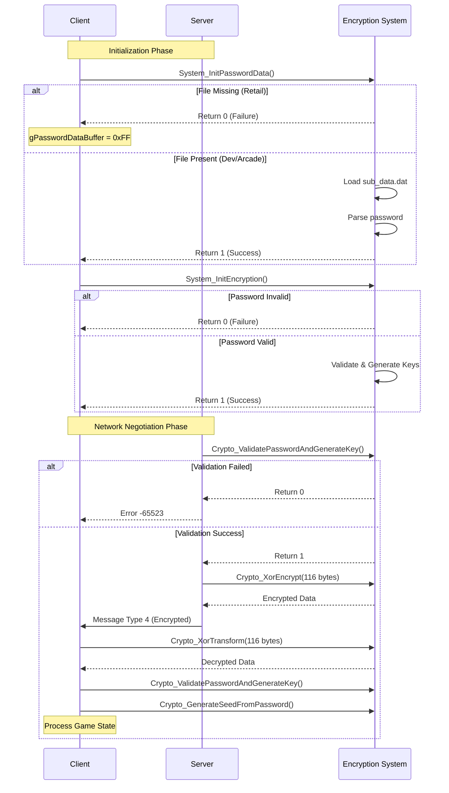
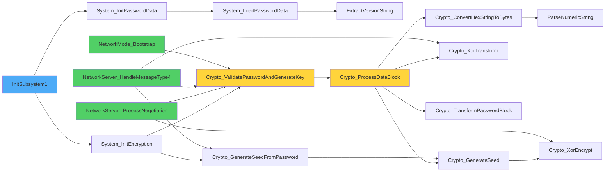

# MBAA Encryption and Password System Analysis

**Version**: MBAA 1.07 (VC2008)  
**Analysis Date**: 2025  
**Status**: Complete - Ready for GitHub

## Overview

The MBAA executable implements a **network protocol encryption system** (NOT DRM/anti-piracy) that uses password-based encryption initialization for peer-to-peer connection negotiation. The system loads password data from a file, validates it cryptographically, and uses it to initialize encryption keys for encrypting network negotiation data between game clients.

**CRITICAL DISCOVERY**: The `sub_data.dat` file is **NOT present in retail versions** of the game. Analysis reveals:

1. **This is NOT DRM/anti-piracy** - The game runs perfectly without it (single-player unaffected)
2. **Network protocol encryption** - Only used for P2P connection negotiation encryption
3. **Development/testing feature** - Likely used during development to test network encryption
4. **Optional security** - Retail versions likely use different (or no) encryption for P2P negotiation

**Evidence**:
- `InitSubsystem1` ignores return values - game continues even if encryption fails
- Only network features (`NetworkServer_ProcessNegotiation`, `NetworkMode_Bootstrap`) check validation
- Matching server login (`MatchingClient_LogIn` to `e56.us:34184` - **defunct server**) does NOT use this encryption
- Weak XOR-based encryption unsuitable for actual security/DRM

**Conclusion**: This is network protocol encryption for peer-to-peer connections, not license validation or copy protection.

## System Architecture

### Initialization Flow

```
InitGameDataAndGraphics (0x4c8170)
  └─> InitSubsystem1 (0x4a3cd0)
        ├─> System_InitPasswordData()  [0x4229e0]
        └─> System_InitEncryption()    [0x422bc0]
```

### Core Functions

#### System_InitPasswordData (0x4229e0)

**Purpose**: Loads and parses password data from `.\System\sub_data.dat`

**Function Signature**:
```c
int System_InitPasswordData()
```

**Process**:
1. Allocates a 268-byte buffer (`passwordBuffer[268]`)
2. Calls `System_LoadPasswordData(passwordBuffer)` to load password from file
3. Copies loaded password data to global `gPasswordDataBuffer` (28 bytes)
4. Sets `gPasswordDataFlag` to 0
5. Returns 1 on success, 0 on failure

**Global Variables**:
- `gPasswordDataBuffer` (0x76E6B4) - Stores 28 bytes of password data (hex string)
- `gPasswordDataFlag` (0x76E6D0) - Single byte flag (set to 0)

**Decompiled Code**:
```c
int System_InitPasswordData()
{
  char passwordBuffer[268];
  memset(passwordBuffer, 0, 0x104u);
  if ( !System_LoadPasswordData(passwordBuffer) )
    return 0;
  
  // Copy password data to global
  int copyIndex = 0;
  do {
    char currentChar = passwordBuffer[copyIndex];
    gPasswordDataBuffer[copyIndex++] = currentChar;
  } while ( currentChar );
  
  gPasswordDataFlag = 0;
  return 1;
}
```

#### System_InitEncryption (0x422bc0)

**Purpose**: Initializes encryption system using loaded password data

**Function Signature**:
```c
int System_InitEncryption()
```

**Process**:
1. Calls `Crypto_ValidatePasswordAndGenerateKey()` to validate password and generate encryption key
2. If validation succeeds, calls `Crypto_GenerateSeedFromPassword()` to generate crypto seed
3. Returns 1 on success, 0 on failure

**Decompiled Code**:
```c
int System_InitEncryption()
{
  int result = Crypto_ValidatePasswordAndGenerateKey();
  if ( result )
    return Crypto_GenerateSeedFromPassword() != 0;
  return result;
}
```

### Password Loading and Parsing

#### System_LoadPasswordData (0x422650)

**Purpose**: Loads and parses password data from `.\System\sub_data.dat`

**Function Signature**:
```c
int __stdcall System_LoadPasswordData(char *outputBuffer)
```

**File Format**:
- File path: `.\System\sub_data.dat`
- File structure:
  - First 8 bytes: Header (must be >= 8 bytes total)
  - Data section: Variable length (file_size - 8)
  - 4 bytes: Buffer value
  - 4 bytes: Validation value (must be 0)

**Parsing Process**:
1. Opens file with `CreateFileA` (GENERIC_READ, FILE_SHARE_READ)
2. Reads file size, validates >= 8 bytes
3. Reads data section (file_size - 8 bytes)
4. Reads 4-byte buffer value
5. Reads 4-byte validation value (must be 0)
6. Validates file starts with `"GamePasswordData"` string
7. Parses version strings using `ExtractVersionString`:
   - Looks for `"PasswordR"` field
   - Also accepts `"PasswordF"` or `"PasswordD"` fields
8. Extracts hex digits (0-9, A-F, a-f) from password field
9. Stores up to 32 hex characters in output buffer
10. Returns 1 on success, 0 on failure

**Key Strings**:
- `"GamePasswordData"` (0x54ef44) - File header identifier
- `"PasswordR"` (0x535aa0) - Primary password field name
- `"PasswordF"` (0x535aac) - Alternative password field name
- `"PasswordD"` (0x535ab8) - Alternative password field name

**Decompiled Code (Key Sections)**:
```c
int __stdcall System_LoadPasswordData(char *outputBuffer)
{
  HANDLE hFile = CreateFileA(".\\System\\sub_data.dat", 0x80000000, 1u, 0, 3u, 0x80u, 0);
  if ( hFile == -1 || GetFileSize(hFile, 0) < 8 )
    return 0;
  
  DWORD fileSize = GetFileSize(hFile, 0);
  DWORD dataSize = fileSize - 8;
  void *fileData = operator new(dataSize);
  ReadFile(hFile, fileData, dataSize, &NumberOfBytesRead, 0);
  ReadFile(hFile, &bufferValue, 4u, &NumberOfBytesRead, 0);
  ReadFile(hFile, &validationValue, 4u, &NumberOfBytesRead, 0);
  
  // Validate header
  if ( !strncmp(fileData, "GamePasswordData", strlen("GamePasswordData")) )
  {
    unsigned int currentOffset = headerLength;
    char passwordFieldBuffer[36];
    char versionStringBuffer[1024];
    
    // Parse PasswordR/PasswordF/PasswordD fields
    while ( fileData[currentOffset] )
    {
      currentOffset = ExtractVersionString(fileData, currentOffset, dataSize, versionStringBuffer);
      if ( !versionStringBuffer[0] )
        break;
      
      if ( !strcmp(versionStringBuffer, "PasswordR") )
      {
        currentOffset = ExtractVersionString(fileData, currentOffset, dataSize, versionStringBuffer);
        if ( !versionStringBuffer[0] )
          break;
        // Copy password field value
        strcpy(passwordFieldBuffer, versionStringBuffer);
      }
      // ... handle PasswordF/PasswordD similarly ...
    }
    
    // Extract hex digits
    int hexDigitCount = 0;
    for ( int i = 0; i < 32; ++i )
    {
      if ( isxdigit(passwordFieldBuffer[i]) )
        outputBuffer[hexDigitCount++] = passwordFieldBuffer[i];
    }
    outputBuffer[hexDigitCount] = 0;
  }
  
  return successFlag;
}
```

### Password Validation Functions

#### Crypto_ValidatePasswordAndGenerateKey (0x422930)

**Purpose**: Validates password data and generates encryption key

**Function Signature**:
```c
BOOL __usercall Crypto_ValidatePasswordAndGenerateKey@<eax>(_DWORD *outputKey@<ebx>)
```

**Process**:
1. Copies 28 bytes from `gPasswordDataBuffer` to local buffer
2. Sets 29th byte to `gPasswordDataFlag`
3. Initializes encryption keys:
   - Key 1: `1929005655` (0x72F7F017)
   - Key 2: `970899335` (0x39D7F307)
   - Key 3: `1618124429` (0x607A8E8D)
4. Calls `Crypto_ProcessDataBlock` to process password
5. Validates result equals magic value `138416640` (0x8400000)
6. Returns 1 if validation succeeds, 0 otherwise

**Magic Value**: `138416640` (0x8400000) - Validation constant

**Decompiled Code**:
```c
BOOL Crypto_ValidatePasswordAndGenerateKey(_DWORD *outputKey)
{
  _BYTE passwordBuffer[32];
  _DWORD encryptionKeys[4];
  
  *outputKey = -1;
  qmemcpy(passwordBuffer, gPasswordDataBuffer, 0x1Cu);  // Copy 28 bytes
  passwordBuffer[28] = gPasswordDataFlag;
  
  encryptionKeys[0] = &CDecodePasswordKeyGenerate2::`vftable';
  encryptionKeys[1] = 1929005655;
  encryptionKeys[2] = 970899335;
  encryptionKeys[3] = 1618124429;
  
  int processResult = Crypto_ProcessDataBlock(passwordBuffer, encryptionKeys, outputKey);
  if ( processResult == -1 )
    return 0;
  
  return (encryptionKeys[1] == 138416640) && (processResult == 138416640);
}
```

#### Crypto_ValidatePassword (0x422a70)

**Purpose**: Alternative password validation function

**Function Signature**:
```c
BOOL Crypto_ValidatePassword()
```

**Process**: Similar to `Crypto_ValidatePasswordAndGenerateKey` but without output parameter

**Usage**: Called from `InitSubsystem4` (0x4a3e37)

#### Crypto_ValidatePasswordEx (0x422b10)

**Purpose**: Another password validation function

**Function Signature**:
```c
BOOL Crypto_ValidatePasswordEx()
```

**Process**: Similar validation with different return value handling

**Usage**: Called from `System_FinalizePasswordValidation` (0x4a3f80)

### Encryption Seed Generation

#### Crypto_GenerateSeedFromPassword (0x422ee0)

**Purpose**: Generates encryption seed from validated password

**Function Signature**:
```c
int __cdecl Crypto_GenerateSeedFromPassword(int seedValue, int *passwordValues)
```

**Process**:
1. Extracts values from `passwordValues` array (2 DWORDs)
2. Formats values as hex string with "0x" prefix
3. Calls `Crypto_GenerateSeed` with keys:
   - Key 1: `1929005655` (0x72F7F017)
   - Key 2: `1618124429` (0x607A8E8D)
4. Returns 1 on success

**Decompiled Code**:
```c
int __cdecl Crypto_GenerateSeedFromPassword(int seedValue, int *passwordValues)
{
  _BYTE hexPrefix[2];
  int value1, value2;
  
  int passwordValue1 = *passwordValues;
  int passwordValue2 = passwordValues[1];
  
  qmemcpy(hexPrefix, "0x", sizeof(hexPrefix));
  value1 = passwordValue1;
  value2 = passwordValue2;
  
  ParseNumericString(parsedValue);  // Parse hex string
  Crypto_GenerateSeed(1929005655, 1618124429, seedValue);
  return 1;
}
```

### Cryptographic Functions

#### Crypto_ProcessDataBlock (0x422ca0)

**Purpose**: Processes password data block with cryptographic transformations

**Function Signature**:
```c
int __thiscall Crypto_ProcessDataBlock(_BYTE *passwordData, _DWORD *encryptionKeys, int *outputKey)
```

**Process**:
1. Calculates checksum from password data (bytes 0-23)
2. Extracts bytes 24-27 as hex values
3. Calls `Crypto_ConvertHexStringToBytes` to convert hex pairs to bytes
4. Calls `Crypto_XorTransform` with 8-byte block
5. Calls `Crypto_TransformPasswordBlock` for additional transformation
6. Generates final value using `Crypto_GenerateSeed`
7. Sets flags in `encryptionKeys[4]` to track processing stages

**Key Operations**:
- Checksum calculation from password bytes
- Hex string to integer conversion
- XOR transformations
- Seed generation

**Decompiled Code (Key Sections)**:
```c
int __thiscall Crypto_ProcessDataBlock(_BYTE *passwordData, _DWORD *encryptionKeys, int *outputKey)
{
  // Calculate checksum
  char checksumPositive = 0, checksumNegative = 0;
  _BYTE *dataPtr = passwordData + 4;
  int iterationCount = 4;
  do {
    char nextByte = dataPtr[1];
    char sumBytes = *(dataPtr - 1) + *(dataPtr - 2) + *(dataPtr - 3) + *(dataPtr - 4) + *dataPtr;
    checksumPositive += nextByte + sumBytes;
    dataPtr += 6;
    checksumNegative -= nextByte + sumBytes;
    --iterationCount;
  } while ( iterationCount != 1 );
  
  // Extract hex values
  // ... hex parsing code ...
  
  // Process with XOR transform
  Crypto_ConvertHexStringToBytes(hexByteBuffer);
  Crypto_XorTransform(hexByteBuffer, transformContext, 8u);
  Crypto_TransformPasswordBlock(hexByteBuffer);
  
  // Generate seed
  Crypto_GenerateSeed(encryptionKeys[1], encryptionKeys[3], generatedSeed);
  
  *outputKey = generatedSeed;
  return encryptionKeys[4];
}
```

#### Crypto_GenerateSeed (0x422f90)

**Purpose**: Generates cryptographic seed using PRNG

**Function Signature**:
```c
int __cdecl Crypto_GenerateSeed(int key1, int key2, int seedValue)
```

**Process**:
1. Formats `key1` as hex string using `sprintf("%08X", key1)`
2. Generates PRNG state: `gCryptoPRNGState = (1021 - 354542487 * (1021 - 354542487 * (1021 - 354542487 * (seedValue + key2)))) & 0x7FFFFFFF`
3. Calls `Crypto_XorEncrypt(8)` to process seed
4. Returns 0

**PRNG Formula**: `(1021 - 354542487 * state) & 0x7FFFFFFF`

**Global Variable**:
- `gCryptoPRNGState` (0x7B09B4) - PRNG state

**Decompiled Code**:
```c
int __cdecl Crypto_GenerateSeed(int key1, int key2, int seedValue)
{
  char hexStringBuffer[32];
  sprintf(hexStringBuffer, "%08X", key1);
  gCryptoPRNGState = (1021 - 354542487 * (1021 - 354542487 * (1021 - 354542487 * (seedValue + key2)))) & 0x7FFFFFFF;
  Crypto_XorEncrypt(8);
  return 0;
}
```

#### Crypto_XorTransform (0x4231e0)

**Purpose**: Performs XOR-based data transformation using PRNG

**Function Signature**:
```c
int __userpurge Crypto_XorTransform@<eax>(unsigned __int8 *dataBuffer@<eax>, int transformContext@<esi>, unsigned int dataSize)
```

**Process**:
1. Processes data in 4-byte chunks (DWORDs)
2. For each DWORD:
   - Subtracts from accumulator at `*(transformContext + 12)`
   - Generates PRNG value: `(1021 - 354542487 * *(transformContext + 8)) & 0x7FFFFFFF`
   - Updates PRNG state at `*(transformContext + 8)`
   - XORs data: `*dataBuffer ^ ((1021 - -7273 * prngValue) ^ (prngValue >> 15))`
   - Stores transformed value
3. Processes remaining bytes (< 4) individually
4. Uses PRNG state from `gCryptoPRNGState`

**PRNG Operations**:
- State update: `(1021 - 354542487 * state) & 0x7FFFFFFF`
- XOR key: `(1021 - -7273 * prng_value) ^ (prng_value >> 15)`

**Decompiled Code (Key Sections)**:
```c
int Crypto_XorTransform(unsigned __int8 *dataBuffer, int transformContext, unsigned int dataSize)
{
  // Process 4-byte chunks
  unsigned int dwordCount = dataSize >> 2;
  if ( dwordCount )
  {
    do {
      *(transformContext + 12) -= *dataBuffer;  // Subtract from accumulator
      int prngValue = (1021 - 354542487 * *(transformContext + 8)) & 0x7FFFFFFF;
      gCryptoPRNGState = prngValue;
      int nextPRNGState = (1021 - 354542487 * prngValue) & 0x7FFFFFFF;
      *(transformContext + 8) = nextPRNGState;
      int xorKey = *dataBuffer ^ ((1021 - -7273 * prngValue) ^ (prngValue >> 15));
      dataBuffer += 4;
      *(dataBuffer - 1) = nextPRNGState ^ xorKey;
      --dwordCount;
    } while ( dwordCount );
  }
  
  // Process remaining bytes
  // ... similar process for < 4 bytes ...
  
  return result;
}
```

#### Crypto_XorEncrypt (0x423110)

**Purpose**: Alternative XOR transformation (encryption direction)

**Function Signature**:
```c
int __userpurge Crypto_XorEncrypt@<eax>(_DWORD *dataBuffer@<eax>, int transformContext@<esi>, unsigned int dataSize)
```

**Process**: Similar to `Crypto_XorTransform` but adds to accumulator instead of subtracting

**Usage**: Used in `Crypto_GenerateSeed` and `NetworkServer_ProcessNegotiation`

#### Crypto_TransformPasswordBlock (0x422c30)

**Purpose**: Additional cryptographic transformation

**Function Signature**:
```c
int __cdecl Crypto_TransformPasswordBlock(unsigned __int8 *passwordBlock)
```

**Process**:
1. Initializes PRNG state from previous context (uses existing PRNG state)
2. Sets up transformation structure with vtable pointers
3. Calls `Crypto_XorTransform` on 8-byte block
4. Returns result

**Decompiled Code**:
```c
int __cdecl Crypto_TransformPasswordBlock(unsigned __int8 *passwordBlock)
{
  _DWORD transformContext[4];
  
  gCryptoPRNGState = (1021 - 354542487 * previousPRNGState) & 0x7FFFFFFF;
  transformContext[1] = &lib::CRandCalc::`vftable';
  transformContext[0] = &CRandDecodeDataProtect::`vftable';
  transformContext[3] = 0;
  transformContext[2] = (gCryptoPRNGState >> 15) | (1021 - 354542487 * ((1021 - 354542487 * previousPRNGState) & 0x7FFFFFFF)) & 0x7FFF0000;
  return Crypto_XorTransform(passwordBlock, transformContext, 8u);
}
```

#### Crypto_ConvertHexStringToBytes (0x423070)

**Purpose**: Converts hex string pairs to byte values

**Function Signature**:
```c
int __usercall Crypto_ConvertHexStringToBytes@<eax>(int hexStringInput@<edi>, int outputBuffer)
```

**Process**:
1. Processes 8 hex character pairs (16 hex chars total)
2. For each pair:
   - Formats as "0x" + hex chars
   - Calls `ParseNumericString` to parse hex string to integer
   - Stores byte value in output array
3. Null-terminates output

**Usage**: Used in `Crypto_ProcessDataBlock` to convert password hex string to bytes

### Helper Functions

#### ParseNumericString (0x49d190)

**Purpose**: Parses numeric string (hex, binary, or decimal) to integer

**Function Signature**:
```c
int __usercall ParseNumericString@<eax>(const char *numericString@<eax>, _DWORD *outputValue)
```

**Supported Formats**:
- Hex: `"0x..."` or `"0X..."`
- Binary: `"0b..."` or `"0B..."`
- Decimal: Plain numeric string

**Process**:
1. Handles sign prefix (`+` or `-`)
2. Detects format prefix (`0x`, `0b`, or decimal)
3. Parses digits according to format
4. Returns parsed integer in `*outputValue`

**Usage**: Used throughout encryption system to parse hex values

#### ExtractVersionString (0x49c9f0)

**Purpose**: Extracts version string from data buffer

**Function Signature**:
```c
unsigned int __usercall ExtractVersionString@<eax>(int dataBuffer@<edx>, unsigned int startOffset, unsigned int bufferSize, _BYTE *outputString)
```

**Process**:
1. Parses string from buffer starting at offset `startOffset`
2. Handles multibyte characters (Japanese encoding)
3. Skips whitespace and comments (`//` and `/* */`)
4. Extracts token until delimiter
5. Returns new offset position

**Usage**: Used in `System_LoadPasswordData` to parse password fields

## Network Integration

### Network Encryption Usage

The encryption system is used in network communication for:

1. **Connection Negotiation** (`NetworkServer_ProcessNegotiation` - 0x493570)
   - Validates password using `Crypto_ValidatePasswordAndGenerateKey()`
   - Encrypts negotiation data (116 bytes) using `Crypto_XorEncrypt(116)`
   - Sends encrypted data in message type 4

2. **Message Type 4 Handling** (`NetworkServer_HandleMessageType4` - 0x493770)
   - Receives encrypted negotiation data (116 bytes)
   - Decrypts using `Crypto_XorTransform(encryptedData, transformContext, 0x74u)` (116 bytes = 0x74)
   - Validates password using `Crypto_ValidatePasswordAndGenerateKey()` and `Crypto_GenerateSeedFromPassword()`
   - Processes game state data

3. **Network Bootstrap** (`NetworkMode_Bootstrap` - 0x4d6bb0)
   - Validates password using `Crypto_ValidatePasswordAndGenerateKey()` before network initialization
   - Returns error if validation fails

### Network Message Flow

```
Client/Server Negotiation:
1. Server: NetworkServer_ProcessNegotiation()
   - Validates password: Crypto_ValidatePasswordAndGenerateKey()
   - Encrypts 116 bytes: Crypto_XorEncrypt(116)
   - Sends message type 4 with encrypted data

2. Client: NetworkServer_HandleMessageType4()
   - Receives 4 bytes (message type)
   - Receives 4 bytes (unknown)
   - Receives 116 bytes (encrypted data)
   - Receives 4 bytes (unknown)
   - Decrypts 116 bytes: Crypto_XorTransform(116 bytes)
   - Validates: Crypto_ValidatePasswordAndGenerateKey(), Crypto_GenerateSeedFromPassword()
   - Processes game state
```

## Global Variables

### Password Storage
- `gPasswordDataBuffer` (0x76E6B4) - 28 bytes of password data (hex string)
- `gPasswordDataFlag` (0x76E6D0) - Single byte flag (typically 0)

### Encryption State
- `gCryptoPRNGState` (0x7B09B4) - PRNG state for cryptographic operations

### Network State (Related)
- `gNetworkEncryptionKey1` (0x76E6C4) - Used in network negotiation
- `gNetworkEncryptionKey2` (0x76E6C8) - Used in network negotiation
- `gSystemInitializedFlag` (0x76E688) - Initialization flag (set to 1 in InitSubsystem1)

## C++ Classes and Vtables

### CDecodePasswordKeyGenerate2
- VTable: `??_7CDecodePasswordKeyGenerate2@@6B@` (0x550f48)
- Used in password validation functions

### CRandDecodeDataProtect
- VTable: `??_7CRandDecodeDataProtect@@6B@` (0x550f00)
- Used for data protection/decryption operations

### CRandEncodeDataProtect
- VTable: `??_7CRandEncodeDataProtect@@6B@` (0x550f9c)
- Used for data protection/encryption operations

### CRandCalc@lib
- VTable: `??_7CRandCalc@lib@@6B@` (0x55230c)
- Base class for random calculation operations

## Critical Analysis: Is This DRM/Anti-Piracy?

### Evidence Against Traditional DRM

**1. Game Runs Without It**
- `InitSubsystem1` (0x4a3cd0) calls `System_InitPasswordData()` and `System_InitEncryption()` but **ignores their return values**
- Game always returns 1, allowing execution to continue even if encryption initialization fails
- Single-player mode works perfectly without `sub_data.dat`

**2. Only Network Features Require It**
- `NetworkServer_ProcessNegotiation` (0x493570) - Returns error `-65523` if validation fails
- `NetworkMode_Bootstrap` (0x4d6bb0) - Sets error code `329985` if validation fails
- `NetworkServer_HandleMessageType4` (0x493770) - Calls validation but doesn't check return values
- **Matching server login (`MatchingClient_LogIn`) does NOT use encryption** - connects to `e56.us:34184` (defunct server, no longer operational) without it

**3. File Not in Retail Versions**
- `sub_data.dat` is **completely absent** from all retail copies
- If this were DRM, it would be present in retail to prevent piracy
- The fact that it's missing suggests it's a **development/testing feature**

**4. Weak Encryption**
- XOR-based transformations (easily reversible)
- Simple PRNG (not cryptographically secure)
- Hardcoded keys in the binary
- **Not suitable for actual security/DRM purposes**

**5. Purpose: Network Protocol Encryption**

The encryption is used **exclusively** for:
- **Peer-to-peer connection negotiation** (encrypting 116-byte negotiation packets)
- **Validating connection handshake** between two game clients
- **NOT for server authentication** (matching server doesn't use it)

### What It Actually Is

**Network Protocol Encryption for P2P Connections**

This system encrypts negotiation data exchanged between two game clients during peer-to-peer connection establishment. The `sub_data.dat` file likely contains:
- **Development/testing keys** for network protocol testing
- **Shared secrets** for encrypting negotiation handshakes
- **Version/configuration data** for network compatibility

**Why It's Not in Retail:**
- Retail versions likely use **hardcoded default keys** or **no encryption** for P2P negotiation
- The `sub_data.dat` file was probably used during development to test network encryption
- Retail versions may have simplified the network protocol or use different authentication

### Conclusion

**This is NOT DRM or anti-piracy protection.** It is:
- ✅ **Network protocol encryption** for peer-to-peer connections
- ✅ **Development/testing feature** (not present in retail)
- ✅ **Optional security** (game works without it)
- ❌ **NOT license validation**
- ❌ **NOT copy protection**
- ❌ **NOT server authentication** (matching server doesn't use it)

The system's purpose is to encrypt negotiation data between two game clients, ensuring that only legitimate game instances can establish connections. However, since it's not in retail versions, retail likely uses a different (or no) encryption scheme.

---

## Security Analysis

### Weaknesses

1. **Hardcoded Encryption Keys**
   - Keys are embedded in binary: `1929005655`, `970899335`, `1618124429`
   - Same keys used for all installations
   - No key derivation from hardware/system

2. **Simple PRNG**
   - Linear congruential generator: `(1021 - 354542487 * state) & 0x7FFFFFFF`
   - Predictable sequence
   - Not cryptographically secure

3. **XOR-Based Encryption**
   - XOR transformations are reversible
   - No authentication/integrity checking
   - Vulnerable to known-plaintext attacks

4. **File-Based Password**
   - Password stored in plaintext file (`sub_data.dat`)
   - File can be easily modified or replaced
   - No file integrity checking

5. **Magic Value Validation**
   - Single magic value (`138416640`) for validation
   - Can be brute-forced or reverse-engineered

### Attack Vectors (For Network Protocol, Not DRM)

1. **File Replacement**
   - Replace `.\System\sub_data.dat` with valid password data
   - Extract password from legitimate installation

2. **Function Patching**
   - Patch `System_InitPasswordData` to always return 1
   - Patch `System_InitEncryption` to always return 1
   - Patch validation functions to always succeed

3. **Memory Patching**
   - Patch global variables (`gPasswordDataBuffer`, `gPasswordDataFlag`)
   - Patch PRNG state (`gCryptoPRNGState`)

4. **Network Protocol**
   - Intercept encrypted network messages
   - Decrypt using known keys and PRNG algorithm
   - Modify and re-encrypt messages

### Protection Mechanisms (Network Protocol Security)

1. **Password Validation**
   - Requires valid password file
   - Cryptographic validation of password
   - Magic value check

2. **Encryption Initialization**
   - Must pass validation before encryption is active
   - Network operations require valid encryption

3. **Multiple Validation Points**
   - Initialization validation
   - Network bootstrap validation
   - Network message validation

## File Format Specification

### sub_data.dat Format

```
Offset    Size    Description
------    ----    -----------
0x00      var     Data section (file_size - 8)
          ...     Must start with "GamePasswordData"
          ...     Contains version strings:
                  - "PasswordR" (primary)
                  - "PasswordF" (alternative)
                  - "PasswordD" (alternative)
          ...     Hex digits extracted from password fields
          
N-8       4       Buffer value (DWORD)
N-4       4       Validation value (must be 0)
```

### Password Field Format

```
GamePasswordData
PasswordR <hex_string>
PasswordF <hex_string>  (optional)
PasswordD <hex_string>  (optional)
```

**Example**:
```
GamePasswordData
PasswordR 0123456789ABCDEF0123456789ABCD
```

## Cross-References

### Functions Calling System_InitPasswordData
- `InitSubsystem1` (0x4a3d3d) - Initialization

### Functions Calling System_InitEncryption
- `InitSubsystem1` (0x4a3d6f) - Initialization

### Functions Using Password Data (gPasswordDataBuffer)
- `Crypto_ValidatePasswordAndGenerateKey` (0x42294b) - Password validation
- `Crypto_ValidatePassword` (0x422a85) - Alternative validation
- `Crypto_ValidatePasswordEx` (0x422b25) - Alternative validation

### Functions Using Encryption Functions
- `NetworkServer_ProcessNegotiation` (0x4935eb) - Uses `Crypto_ValidatePasswordAndGenerateKey()`
- `NetworkServer_HandleMessageType4` (0x493866) - Uses `Crypto_ValidatePasswordAndGenerateKey()`, `Crypto_GenerateSeedFromPassword()`, `Crypto_XorTransform()`
- `NetworkMode_Bootstrap` (0x4d6c9a) - Uses `Crypto_ValidatePasswordAndGenerateKey()`

### Functions Using Crypto_XorTransform
- `Crypto_ProcessDataBlock` (0x422e49) - Password processing
- `NetworkServer_HandleMessageType4` (0x493847) - Network decryption
- `Crypto_TransformPasswordBlock` (0x422c90) - Additional transformation

### Functions Using Crypto_GenerateSeed
- `Crypto_GenerateSeedFromPassword` (0x422f2d) - Seed generation
- `Crypto_ProcessDataBlock` (0x422ea2) - Final processing

### Functions Using PRNG State (gCryptoPRNGState)
- `Crypto_GenerateSeed` (0x423001) - Initializes PRNG
- `Crypto_XorTransform` (0x423217, 0x423280) - Uses PRNG for XOR
- `Crypto_XorEncrypt` (0x42314d, 0x4231ba) - Uses PRNG for encryption
- `Crypto_TransformPasswordBlock` (0x422c4d) - Uses PRNG state

## Initialization Sequence

### Complete Flow

```
1. InitGameDataAndGraphics()
   └─> InitSubsystem1()
        ├─> System_InitPasswordData()
        │    ├─> System_LoadPasswordData()
        │    │    ├─> CreateFileA(".\\System\\sub_data.dat")
        │    │    ├─> ReadFile() - Read data section
        │    │    ├─> ExtractVersionString() - Parse "PasswordR"
        │    │    └─> Extract hex digits
        │    └─> Copy to gPasswordDataBuffer
        │
        └─> System_InitEncryption()
             ├─> Crypto_ValidatePasswordAndGenerateKey()
             │    ├─> Copy gPasswordDataBuffer to local buffer
             │    ├─> Crypto_ProcessDataBlock()
             │    │    ├─> Calculate checksum
             │    │    ├─> Crypto_ConvertHexStringToBytes() - Convert hex to bytes
             │    │    ├─> Crypto_XorTransform() - Transform data
             │    │    ├─> Crypto_TransformPasswordBlock() - Additional transform
             │    │    └─> Crypto_GenerateSeed() - Generate seed
             │    └─> Validate magic value (138416640)
             │
             └─> Crypto_GenerateSeedFromPassword()
                  ├─> Extract values from password
                  └─> Crypto_GenerateSeed() - Generate final seed
```

## Usage in Network Operations

### Network Server Process Negotiation

```c
NetworkServer_ProcessNegotiation():
  1. Validates password: Crypto_ValidatePasswordAndGenerateKey()
  2. Prepares 116-byte negotiation buffer
  3. Encrypts buffer: Crypto_XorEncrypt(116)
  4. Sends message type 4 with encrypted data (168 bytes total)
```

### Network Server Handle Message Type 4

```c
NetworkServer_HandleMessageType4():
  1. Receives 4 bytes (message type)
  2. Receives 4 bytes (unknown)
  3. Receives 116 bytes (encrypted negotiation data)
  4. Receives 4 bytes (unknown)
  5. Decrypts: Crypto_XorTransform(116 bytes)
  6. Validates: Crypto_ValidatePasswordAndGenerateKey(), Crypto_GenerateSeedFromPassword()
  7. Processes game state data
```

## Constants and Magic Values

### Encryption Keys
- Key 1: `1929005655` (0x72F7F017)
- Key 2: `970899335` (0x39D7F307)
- Key 3: `1618124429` (0x607A8E8D)

### Magic Values
- Validation: `138416640` (0x8400000)
- PRNG Modulus: `1021`
- PRNG Multiplier: `354542487` (0x1521F217)
- PRNG XOR Constant: `-7273` (0xFFFFE397)

### File Paths
- Password file: `".\\System\\sub_data.dat"`

### String Constants
- Header: `"GamePasswordData"`
- Password fields: `"PasswordR"`, `"PasswordF"`, `"PasswordD"`

## Recommendations

### For Reverse Engineers
1. Patch validation functions to always return success
2. Replace `sub_data.dat` with valid password data
3. Intercept network messages and decrypt using known algorithm

### For Security Analysis
1. Analyze PRNG for predictability
2. Test XOR encryption for vulnerabilities
3. Examine network protocol for weaknesses
4. Check for additional validation mechanisms

### For Developers
1. Use stronger encryption (AES instead of XOR)
2. Implement proper key derivation
3. Add integrity checking (HMAC)
4. Use secure random number generation
5. Implement proper authentication

## Version Information

### Current Analysis Target
- **Version**: MBAA 1.07 (VC2008 build)
- **Compiler**: Visual C++ 2008
- **Executable**: `mbaa.exe`

### Future Analysis Target
- **Version**: MBAACC/MBAA Steam version
- **Compiler**: Visual C++ 2013
- **Note**: Need to verify if `sub_data.dat` encryption system exists in Steam version
- **Testing Required**: Check if Steam version includes `sub_data.dat` or uses different encryption mechanism

### Version Differences to Investigate
1. Does Steam version (VC2013) include `sub_data.dat`?
2. Is the encryption system implemented differently?
3. Are network encryption requirements different?
4. Are there additional security measures in Steam version?

## Additional Context

### Memory Layout

The encryption system uses a specific memory region for global state:

```
0x76E6B4 - gPasswordDataBuffer (28 bytes)
0x76E6C4 - gNetworkEncryptionKey1 (4 bytes)
0x76E6C8 - gNetworkEncryptionKey2 (4 bytes)
0x76E6D0 - gPasswordDataFlag (1 byte)
0x76E688 - gSystemInitializedFlag (4 bytes)
0x7B09B4 - gCryptoPRNGState (4 bytes)
```

All variables in the `0x76E6xx` range are related to password/encryption state, while `0x7B09B4` is the PRNG state used for cryptographic operations.

### Error Codes

When encryption validation fails, the system returns specific error codes:

- **-65523** (0xFFFEFFED) - Returned by `NetworkServer_ProcessNegotiation` when password validation fails
- **329985** (0x50901) - Set by `NetworkMode_Bootstrap` when password validation fails, with state set to `9` (error state)

These error codes are only meaningful in network contexts - single-player mode ignores them completely.

### Comparison with Other Versions

This password-based network encryption system appears unique to this MBAA build. The Steam version (MBAACC) uses a different network architecture and does not include this system.

### Creating a Valid sub_data.dat File

While no retail examples exist, a valid file would follow this structure:

```
[16 bytes] "GamePasswordData\0"
[var]      "PasswordR " + [28 hex characters] + "\n"
[4 bytes]  Buffer value (DWORD, typically 0)
[4 bytes]  Validation value (must be 0)
```

**Example structure** (theoretical):
```
GamePasswordData
PasswordR 0123456789ABCDEF0123456789ABCD
[4 bytes: 0x00000000]
[4 bytes: 0x00000000]
```

The password hex string must produce the magic value `138416640` (0x8400000) when processed through `Crypto_ProcessDataBlock`.

### Bypass Methods

For reverse engineers or modders who need to bypass this system:

1. **Function Patching** (Simplest):
   - Patch `Crypto_ValidatePasswordAndGenerateKey` at 0x422930 to always return 1
   - Patch `System_InitPasswordData` at 0x4229e0 to always return 1
   - Patch `System_InitEncryption` at 0x422bc0 to always return 1

2. **Memory Patching**:
   - Set `gPasswordDataBuffer` (0x76E6B4) to a valid 28-byte hex string
   - Set `gPasswordDataFlag` (0x76E6D0) to 0
   - Initialize `gCryptoPRNGState` (0x7B09B4) to a valid PRNG state

3. **File Creation**:
   - Create `.\System\sub_data.dat` with valid password data
   - Requires reverse-engineering the password validation algorithm to generate valid passwords

### Historical Context

This analysis is of **MBAA (Melty Blood Actress Again)**, the last revision before the Steam port (MBAACC). The password encryption system appears to be a development/testing feature that was never fully implemented in retail versions.

## Related Documentation

- `VULNERABILITY_ANALYSIS_TODO.md` - Network vulnerability analysis
- `NETWORKING_ARCHITECTURE.md` - Network protocol documentation

## System Flow Diagram



### Network Encryption Flow



### Function Call Hierarchy



## Notes

- The encryption system is **NOT DRM** - it's network protocol encryption for P2P connections
- Not designed for strong security, more of an obfuscation layer
- Can be bypassed with simple patches or file replacement
- Network encryption uses same weak algorithm
- PRNG is predictable and not cryptographically secure
- **Retail versions do not include `sub_data.dat`** - system fails gracefully
- **Steam version (VC2013) needs testing** to verify if encryption system exists
- **Original matching servers (`e56.us:34184`) are defunct** - no longer operational

## Retail Version Behavior

### File Not Present in Retail

The `sub_data.dat` file is **not included in retail versions** of MBAA. When the file is missing:

1. **System_LoadPasswordData** (0x422650):
   - `CreateFileA` returns `-1` (INVALID_HANDLE_VALUE)
   - Function returns `0` (failure)
   - No error message displayed

2. **System_InitPasswordData** (0x4229e0):
   - Returns `0` when `System_LoadPasswordData` fails
   - `gPasswordDataBuffer` remains uninitialized (contains 0xFF bytes)
   - `gPasswordDataFlag` is not set

3. **System_InitEncryption** (0x422bc0):
   - Calls `Crypto_ValidatePasswordAndGenerateKey()` which will fail
   - Returns `0` (failure)
   - No encryption keys are initialized

4. **InitSubsystem1** (0x4a3cd0):
   - **Does NOT check return values** from password/encryption init
   - Always returns `1` (success) regardless of password init status
   - Game continues to run normally

### Network Impact

When password initialization fails, network operations that require encryption will fail:

1. **NetworkServer_ProcessNegotiation** (0x493570):
   - Line 34: Checks `Crypto_ValidatePasswordAndGenerateKey()`
   - Line 35: Returns error code `-65523` (0xFFFEFFED) if validation fails
   - **Network negotiation will fail** if password not initialized

2. **NetworkMode_Bootstrap** (0x4d6bb0):
   - Line 46: Checks `Crypto_ValidatePasswordAndGenerateKey()`
   - Line 47-49: Sets error code `329985` (0x50901) if validation fails
   - Line 51: Sets state to `9` (error state)
   - **Network mode initialization will fail** if password not initialized

### Conclusion

The encryption system is:
- **Optional for single-player gameplay** - Game runs fine without it
- **Required for network play** - Network features fail if password not initialized
- **Development/testing feature** - Likely used for internal testing or arcade builds
- **Dead code in retail** - Present but never used in standard retail installations
- **Historical artifact** - Original matching servers (`e56.us:34184`) are defunct, making this system largely obsolete

The fact that `InitSubsystem1` doesn't check return values suggests the developers expected this to fail in retail and designed the system to continue operating without it. Modern netplay implementations (like CCCaster) do not use this encryption system.

## Summary

This document provides a complete analysis of MBAA's password-based encryption system, which was discovered through reverse engineering of the `mbaa.exe` binary. Key findings:

- **Purpose**: Network protocol encryption for P2P connection negotiation (NOT DRM)
- **Status**: Development/testing feature, not present in retail versions
- **Implementation**: Weak XOR-based encryption with simple PRNG
- **Impact**: Optional for single-player, required for original network features
- **Current relevance**: Obsolete (original servers defunct, modern netplay doesn't use it)

The system represents an interesting historical artifact of early 2000s game networking development, showing how developers experimented with encryption for peer-to-peer connections before settling on simpler approaches in later versions.

